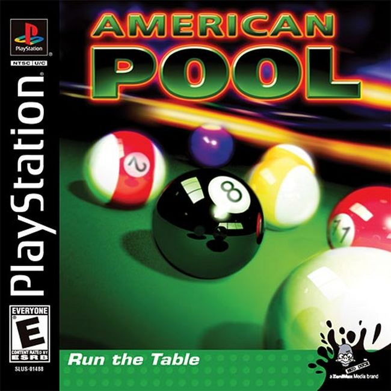
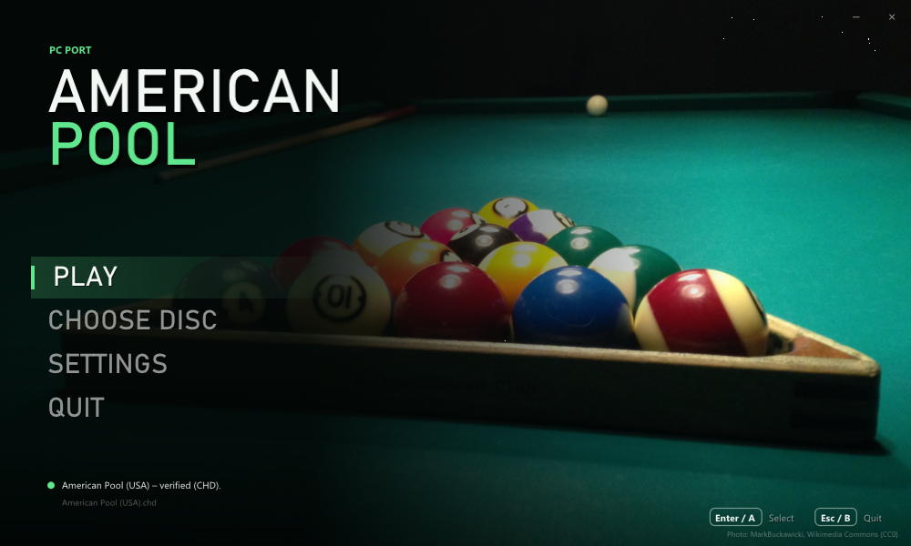
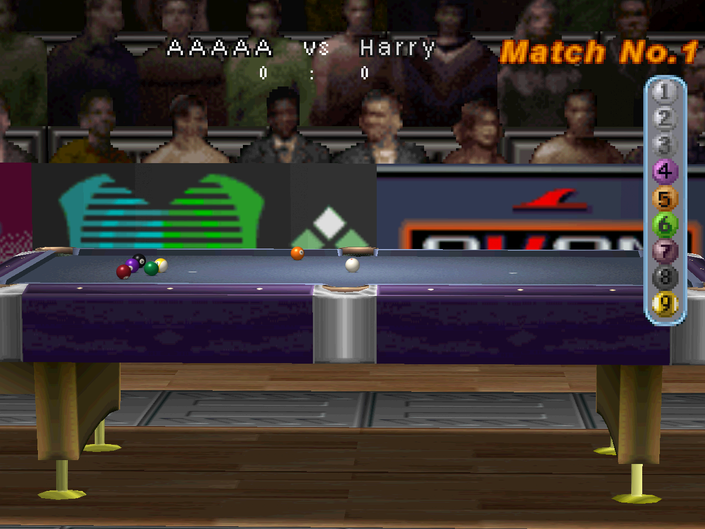

# American Pool – PC port

A native Windows version of the PlayStation game **American Pool**
(SLUS-01488). It runs the game's own logic natively on Windows – no
emulator and no BIOS – with sharper graphics and a number of quality-of-life
improvements.

**You need your own copy of the game.** The port reads the graphics, sound
and data from a disc image that you make from your own original disc.

  
   
  <em>The game this port needs: American Pool (USA), SLUS-01488. Cover © its respective owners.</em>

## Download

**[⬇ Download the latest release (american-pool-pc.zip)](https://github.com/bitsandbreakpoints/american-pool-pc/releases/latest/download/american-pool-pc.zip)**

All releases are on the [Releases page](https://github.com/bitsandbreakpoints/american-pool-pc/releases).

1. Download `american-pool-pc.zip` and unzip it anywhere.
2. Start `american_pool.exe` (Windows 10 or later; no installation).
3. Click **CHOOSE DISC** and pick your disc image, or drop it on the window.
   `.bin`/`.cue`, `.chd` and `.iso` work. The launcher checks the image
   against the known dump of *American Pool (USA)*.
4. Click **PLAY**.

*In-game picture: American Pool running in this port at 4× internal
resolution. The game's graphics shown here are © their respective owners.*

## Disclaimer

- **You must own the game.** To play, you need a dump (disc image) of your
  own original *American Pool (USA)* disc. This project does not provide,
  and will not help you find, game files.
- **This repository contains no game files:** no code, graphics, sound,
  music, video or data files from the game, and no BIOS. It holds only
  this README, the third-party licence list and pictures: our banner, the
  launcher (our own, with a public-domain photo), plus the box cover and an
  in-game picture, which are © their respective owners and shown only to
  identify the game.
- **No game assets are distributed.** The release contains the port's own
  program and the licences of the open-source libraries it uses. Every
  graphic, sound and video is read at run time from your own disc image.
  The program is the game's logic rebuilt for Windows; it includes the
  small tables the code needs (menu texts, table layouts – about 30 KB) but
  none of the game's assets.
- *American Pool* is a trademark of its owner. This is a non-commercial fan
  project and is not affiliated with or endorsed by DigiCube, Mud Duck
  Productions or Sony.

## Improvements over the original

All of these can be changed under **SETTINGS** (and most of them in the
game with **F1**).

**Graphics**
- **Higher internal resolution**, up to 4× (1280 × 960), with the HUD and
  menus kept pixel-exact.
- **Precise vertices** (PGXP-like): no PS1 "wobble", and perspective-correct
  textures on the table, cloth and cue.
- **Smooth 3D textures** – bilinear filtering of 3D surfaces only, so text
  and 2D graphics stay sharp.
- **Round balls**: the balls are redrawn as sharp, shaded spheres with
  their numbers and stripes, instead of the original's low-resolution
  ball pictures.
- **Fixes for the original's 3D glitches**: no cracks across the cloth or
  at the pockets when the camera moves, and the gold feet of the table legs
  no longer disappear behind the floor.
- **Picture filters**: sharp pixels, bilinear, CRT, or a soft-TV filter
  (GTU-like) that smooths the whole picture, HUD included.
- **Window or borderless full screen**, any window size, 4:3 or stretched,
  vsync.

**Gameplay**
- **Fast forward** (Triangle / Y): one press skips the computer's turn, the
  rolling balls after your own shot, or the lag (banking) – the game runs
  as fast as it can until it is your turn or the balls stop.
- **Skip the intro** logos.
- **Quit from the title screen** with B / Esc.

**Comfort**
- **Launcher**: a resizable splash window that remembers its size; choose
  and verify the disc, change every setting, with mouse, keyboard or
  controller.
- **In-game settings** with F1 (or Select + Start).
- **Controls**: keyboard or XInput controllers (Xbox and compatible), two
  players, every button remappable, automatic mapping.
- **Sound**: master, music and effects volume; the music keeps its pace
  even if a frame is slow.
- **Memory card** in a `.mcd` file (the same format as DuckStation and
  other emulators), so saves can move between them.
- **Disc images**: `.bin`/`.cue`, `.chd` (compressed) and `.iso`.

## Controls

Plug-and-play with modern controllers!

| PS1 | Keyboard (player 1) | Controller |
|---|---|---|
| D-pad | Arrow keys | D-pad or left stick |
| Cross | X | A |
| Circle | C | B |
| Square | Z | X |
| Triangle | S | Y |
| L1 / R1 | Q / E | LB / RB |
| L2 / R2 | 1 / 3 | LT / RT |
| Start | Enter | Start |
| Select | Backspace | Back |

Player 2 uses I J K L and the numeric keypad by default. Everything can be
changed under **SETTINGS → CONTROLS**.

In the game: **Esc** goes back to the launcher, **F1** (or Select + Start)
shows the settings, **Triangle / Y** fast-forwards.

## Files

Everything stays in the program's folder:

- `settings.ini` – the settings.
- `saves/memcard1.mcd` – the memory card (the path can be changed under
  **SETTINGS → SAVES**).
- `american_pool.log` – a log for troubleshooting.

## FAQ

**Do I need a BIOS?** No. Everything the BIOS and Sony's libraries do on a
PlayStation is written anew in the port.

**Which version of the game?** *American Pool (USA)*, SLUS-01488. Other
dumps of the same game may work; the launcher tells you if your image is
not the known one.

**Is the source code available?** No. The port is built from a
decompilation of the game, which is not published.

## Credits

- Launcher photo: [Billiards_Rack.JPG](https://commons.wikimedia.org/wiki/File:Billiards_Rack.JPG)
  by MarkBuckawicki, CC0 1.0 (public domain).
- Built with [Dear ImGui](https://github.com/ocornut/imgui),
  [libchdr](https://github.com/rtissera/libchdr) (with zstd, LZMA SDK,
  miniz and dr_flac) and [stb_image](https://github.com/nothings/stb).
  Their licences are in [THIRD_PARTY.md](THIRD_PARTY.md) and in the
  `licenses` folder of the release.
